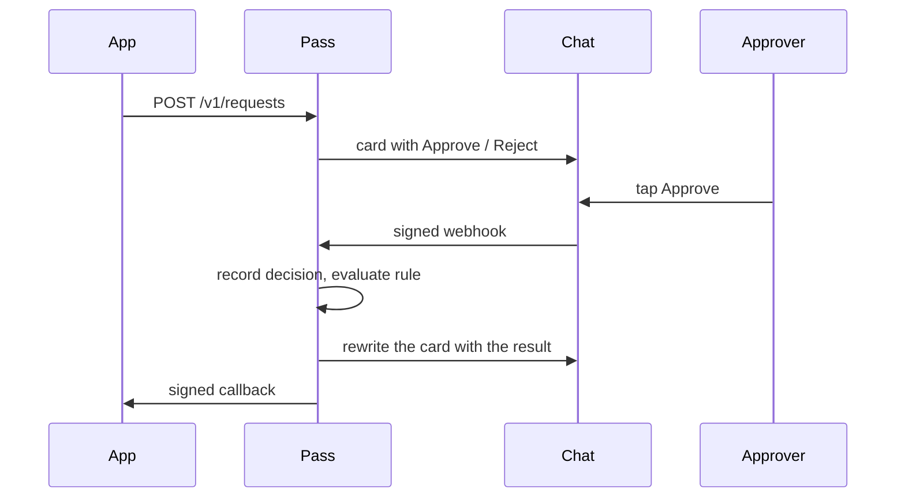

# Pass Approval

A small approval service. A caller opens a request. The people who must decide get a message in the chat they already use. They tap Approve or Reject. When the rule is satisfied, Pass calls the caller back.

Telegram, WhatsApp, and Discord are adapters. Slack, email, or a web inbox are the same kind of adapter. The decision rules never import a chat SDK.

## What a request is

A request is one question with a deadline.

| Field | Meaning |
| --- | --- |
| `external_ref` | The caller's id. Unique per tenant. Creating the same ref twice returns the existing request. |
| `title`, `body`, `fields` | What the approver reads. Fields are label/value pairs, display only. |
| `approvers` | Internal user ids. |
| `rule` | `any`, `all`, or `sequence`. |
| `callback_url` | Where the final result is posted. |
| `expires_in` | Seconds until an unanswered request becomes `expired`. |

Statuses: `pending` → `approved` | `rejected` | `expired` | `cancelled`.

A terminal status never changes.

## Rules

One request, one rule.

| Rule | Passes when | Fails when |
| --- | --- | --- |
| `any` | The first approver approves. | Any approver rejects, or the request expires. |
| `all` | Every approver approves. | Any approver rejects, or the request expires. |
| `sequence` | Each step passes, in order. A step is itself `any` or `all`. | A step is rejected, or the request expires. |

Reject is a veto on every rule. The next step in a sequence is notified only after the current step passes. People in later steps do not get a message early.



## API

Tenant auth is `Authorization: Bearer <api key>`. Keys are stored as a hash.

### Create

`POST /v1/requests`

```json
{
  "external_ref": "deploy-1842",
  "title": "Deploy billing-api to prod",
  "body": "sha 9f3c1a by ada",
  "fields": [{ "label": "Env", "value": "prod" }],
  "rule": "any",
  "approvers": ["ada", "bob"],
  "callback_url": "https://app.example/hooks/pass",
  "expires_in": 86400
}
```

`sequence` replaces `approvers` with ordered steps:

```json
{
  "rule": "sequence",
  "steps": [
    { "rule": "all", "approvers": ["ada", "bob"] },
    { "rule": "any", "approvers": ["chao"] }
  ]
}
```

Response: `{ "id": "req_…", "status": "pending" }`.

A repeat `external_ref` returns the current request and does not notify again.

### Read and cancel

- `GET /v1/requests/:id` returns the request, decisions, and status.
- `POST /v1/requests/:id/cancel` moves a `pending` request to `cancelled` and rewrites open cards. Cancelling a terminal request is a no-op.

### Callback

Posted to `callback_url` when the request leaves `pending`. At-least-once. The caller dedupes on `id` + `status`.

```json
{
  "id": "req_…",
  "external_ref": "deploy-1842",
  "status": "approved",
  "decided_at": "2026-10-24T15:04:11Z",
  "decisions": [
    {
      "approver": "ada",
      "action": "approve",
      "channel": "telegram",
      "comment": "",
      "at": "2026-10-24T15:04:11Z"
    }
  ]
}
```

Headers:

- `X-Pass-Timestamp` — unix seconds
- `X-Pass-Signature` — hex HMAC-SHA256 of `timestamp + "." + raw body`, keyed with the tenant secret

Reject the callback when the timestamp is older than 5 minutes, or the signature does not match. Retries use the same body and a new timestamp. Backoff for 24 hours, then one dead-letter row.

## Who may tap the button

An internal user is linked to a chat account before a tap counts.

1. `POST /v1/link-codes` with `{ "user": "ada" }` returns a 6-digit code, valid for 10 minutes.
2. Ada sends `/link 482913` to the bot (or the WhatsApp number, or the Discord bot).
3. Pass stores `(user, channel, external_user_id)`.

A tap from an unlinked account is ignored. A tap is accepted only when the linked user is an approver on that request, on the step that is open.

## The card and the token

Every channel renders the same card:

- title, body, fields
- two actions while `pending`: Approve, Reject
- after a decision, the same card with the outcome and no buttons

Each button carries an action token, not the request payload. The token is 128 random bits. Pass stores `sha256(token)` bound to `(request, approver, action)`. It expires with the request and is single-use.

Telegram callback data is limited to 64 bytes, so the token is the whole payload. Discord `custom_id` and WhatsApp button ids work the same way.

A second tap on a finished request edits the card to the current status and writes nothing new. The unique key is `(request_id, step_index, approver_id)`.

## Channel adapter

```ts
type Card = {
  title: string
  body: string
  fields: { label: string; value: string }[]
  actions: { token: string; label: string; style: "primary" | "danger" }[]
}

type Inbound = {
  externalUserId: string
  token: string
}

interface Channel {
  send(to: string, card: Card): Promise<{ messageId: string }>
  edit(to: string, messageId: string, card: Card): Promise<void>
  verify(headers: Headers, rawBody: Buffer): void
  parse(body: unknown): Inbound | null
}
```

`verify` runs before `parse`. A failed verify is a 401 and is not a decision.

Core flow after a valid inbound:

1. Look up the token hash. Missing, used, or expired → edit the card if we still know the message, and stop.
2. Confirm the external user is linked to the approver on the token.
3. Insert the decision. On conflict, stop.
4. Evaluate the open step and the request rule.
5. Edit every open card for this request.
6. If the request just became terminal, enqueue the callback.

### Telegram

- One bot, webhook, `X-Telegram-Bot-Api-Secret-Token` checked against the configured secret.
- Inline keyboard, `callback_data` = token.
- Answer the callback query immediately, then edit the message.

### Discord

- Interactions endpoint. Verify the Ed25519 signature (`X-Signature-Ed25519`, `X-Signature-Timestamp`) before any other work. Discord requires a response in 3 seconds, so ack with a deferred update, then edit.
- Buttons in a DM. `custom_id` = token.
- A guild message is fine only in a channel whose members are exactly the approvers. v1 sends DMs so the card is not sitting in a public channel.

### WhatsApp

Cloud API, verify `X-Hub-Signature-256`.

WhatsApp will not deliver a free-form interactive message to someone who has not written to the business number in the last 24 hours. That is the ceiling of this adapter.

- Inside the 24-hour window: an interactive message, two reply buttons, button id = token.
- Outside it: a pre-approved utility template with one URL button. The URL is `https://pass.example/a/<token>` and opens a page with the same card and the same two actions. The page posts to the same decision path. The token is still single-use.

Adding Slack later is a new `Channel`: Block Kit buttons, signing secret, `action_id` = token. Email is a `Channel` whose "button" is the same HTTPS link used by the WhatsApp fallback.

## Data

Postgres is the only store. A token lookup is a primary-key read; a cache can wait until that read shows up in a profile.

| Table | Holds |
| --- | --- |
| `tenants` | id, name, api_key_hash, callback_secret |
| `users` | id, tenant_id, name |
| `channel_identities` | user_id, channel, external_user_id, linked_at. Unique on `(channel, external_user_id)`. |
| `requests` | id, tenant_id, external_ref, title, body, fields jsonb, rule, steps jsonb, status, callback_url, expires_at. Unique on `(tenant_id, external_ref)`. |
| `messages` | request_id, channel, external_user_id, message_id. Used to edit the card. |
| `decisions` | request_id, step_index, approver_id, action, channel, comment, created_at. Unique on `(request_id, step_index, approver_id)`. |
| `action_tokens` | token_hash primary key, request_id, approver_id, action, used_at |
| `callback_outbox` | request_id, body, attempts, next_at, dead |
| `link_codes` | code_hash, user_id, expires_at, used_at |

Decisions and status changes are inserts. A request row's `status` is updated in the same transaction as the decision that caused it.

Expiry is a worker: `UPDATE … WHERE status = 'pending' AND expires_at < now()` and then the same callback path. Run it once a minute.

## Layout

```
pass/
  api/            create, get, cancel, link-codes, webhooks, the one-tap page
  core/           rules, tokens, outbox
  channels/       telegram.ts  whatsapp.ts  discord.ts
  worker/         expiry and callback retry
```

`core/` takes a `Channel` and a database. It has no HTTP types in it.

## v1 cut

Ship with `any`, `all`, and `sequence`, three channels, link codes, signed callbacks, and the WhatsApp link fallback. Leave out a form builder, attachments, nested requests, and delegation.

## Check

One runnable check: given a request with rule `all` and approvers A and B, A's approve leaves it `pending`, B's approve moves it to `approved`, and a token presented twice inserts one decision. A `sequence` of two `any` steps does not notify step 2 until step 1 passes. That test does not open a socket to Telegram.
