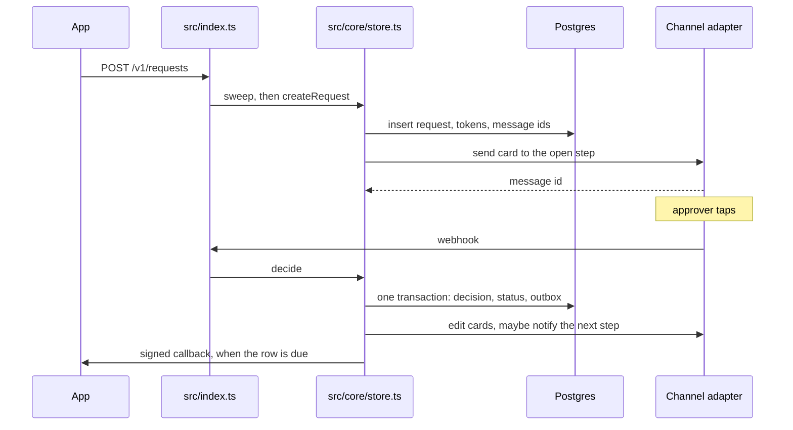

# Implementation

What each file is for, why it is shaped that way, and where the app gets slow.

The product contract is [DESIGN.md](DESIGN.md) and [PRD.md](PRD.md). Hosting limits are in [DEPLOY.md](DEPLOY.md).

When this pass finished the app, `src/db.ts`, `src/core/rules.ts`, `src/core/tokens.ts`, and `src/core/store.ts` were already written. `src/core/channel.ts` was empty, and the HTTP app, the chat adapters, the check, and `schema.sql` did not exist. Those are the files this pass added. Two types were added so the store can run inside a transaction, and `tsconfig.json` was changed so `tsc` accepts the `.ts` import paths Node needs.

## How a request moves

`core/` never imports Hono or a chat SDK. It receives a database handle and a map of `Channel`s. That split is why the check can run the real rules with `MemoryChannel` and never open a socket to Telegram.

## Files

### `schema.sql`

Creates the tables from the design and seeds a dev tenant. The API key for that tenant is `dev-key`. The value stored in `api_key_hash` is the SHA-256 of that key. `callback_secret` is `dev-callback-secret`.

`action_tokens.step_index` is the column the design table omitted. A token has to name the step it belongs to, because a decision is unique on `(request_id, step_index, approver_id)` and a tap on a later step must be ignored while an earlier step is open.

`requests_pending_expiry` is a partial index on `expires_at` for rows that are still `pending`. The sweep's update uses that predicate.

Foreign keys use `on delete cascade`. The check creates a tenant and deletes that one row at the end. The cascade removes its users, requests, tokens, and outbox rows.

The seed uses `on conflict do nothing`, so running the file again does not duplicate `ten_dev`.

### `src/db.ts`

One postgres.js client, imported by the HTTP app and the check.

`ssl: "require"` because Neon rejects a plaintext connection. `max: 1` because a Vercel instance should hold a single connection through the pooler. `prepare: false` because the pooled URL is transaction-mode PgBouncer. postgres.js otherwise names a prepared statement and expects it to still exist on the next query. The pooler may hand that next query to a different session, and the statement is gone.

`Db` is the top-level client. `Query` is that client or a transaction handle. postgres.js types `TransactionSql` as a smaller object than `Sql`, so a function that both `sql.begin` and the outer client call has to accept the union. `loadRequest`, `present`, and `enqueue` take `Query` for that reason.

### `src/core/channel.ts`

The shared card. Every adapter renders the same fields: title, body, label/value pairs, and zero or two actions.

`linkToken` is the extra field. WhatsApp's template has one URL. The page behind that URL has to offer both Approve and Reject. The two button tokens are single-purpose, and only their hashes are stored, so they cannot be recovered later to build the other button. A third token, action `open`, is created at send time and put on the card. Telegram and Discord ignore it.

`verify` returns a promise. Discord's Ed25519 check is async. One signature for all three adapters keeps `index.ts` identical: read the raw bytes, verify, then parse.

`renderText` is the plain-text body every adapter slices to its own limit.

### `src/core/rules.ts`

Pure functions. No database, no HTTP.

`normalizeSteps` turns the create body into a list of steps. `any` and `all` become one step. `sequence` must already be a list of `any` or `all` steps. Duplicate approvers inside one step are rejected.

`evaluate` walks the steps in order. A reject on the step being looked at returns `rejected` immediately. That is the veto. A step that has not passed returns `pending`. If every step has passed, the request is `approved`.

`openStepIndex` returns the first step that has not passed, or nothing when the request is already approved or rejected. Notify and decide both use it, so a sequence cannot message step 2 while step 1 is open.

### `src/core/tokens.ts`

`newToken` is 16 random bytes, 128 bits, encoded as base64url. That string is 22 characters, inside Telegram's 64-byte `callback_data` limit. The same encoding fits Discord `custom_id` and a WhatsApp button id.

`hashToken` is SHA-256 hex. API keys, link codes, and action tokens all go through it. The raw token is what the button carries. The database stores the hash, so a dump of `action_tokens` does not let someone tap.

`newLinkCode` is six digits. `newId` prefixes `req_` or `ten_` onto 12 random bytes.

### `src/core/store.ts`

The decision path. HTTP and the check both call these functions.

**Auth.** `tenantFromAuthorization` hashes the bearer token and looks up `tenants.api_key_hash`. The comparison is the lookup. A missing row is a 401 at the route.

**Create.** Approver ids must already be users of that tenant. The insert uses `on conflict (tenant_id, external_ref) do nothing`. A repeat returns the existing id and does not call `notify`. `expires_in` is seconds added to now.

**Notify.** For each approver on the open step, load their linked chats. No link means no card, and the request still exists. Three tokens are inserted: `approve`, `reject`, and `open`. Then each linked channel gets `send`, and the message id is stored so a later decision can edit that card. A throw from `send` is logged and skipped. The request row stays. A later create with the same `external_ref` will not try again.

**Decide.** One transaction. The token row is locked with `for update`, so two taps of the same token queue. The checks after the lock, in order:

1. Unknown token: stop. There is no card to edit.
2. Token already used, or the request is not `pending`, or `expires_at` has passed: stop. A finished request still gets its cards rewritten.
3. An `open` token takes the action from the page. Holding that token is the credential, so the chat-link check is skipped. A button token must belong to the linked user.
4. The token's step must be the open step, and the approver must be on that step.
5. Insert the decision. The unique key makes a second insert affect zero rows.
6. Mark the token used.
7. If `evaluate` is no longer `pending`, set the status only from `pending`, and insert the outbox row in the same transaction.

Chat calls happen after the commit. A failed edit does not roll back the decision.

While the request stays `pending`, only the voters' cards are edited, and those edits have no buttons. The other approvers keep the keyboards they were sent. The raw tokens are not stored, so those keyboards cannot be rebuilt. When the status leaves `pending`, every stored message is rewritten with the outcome and no buttons.

If the open step index changed, `notify` runs for the new step. That is the sequence handoff.

**Cancel.** Updates `pending` to `cancelled`, enqueues the callback, rewrites cards. A terminal row is left alone. The route still returns the current request.

**Link codes.** Six digits, hashed, 10 minutes, single use. Redeeming writes `channel_identities`. The same chat account linking again replaces the user, because of `on conflict (channel, external_user_id)`.

**Sweep.** One update expires every pending row past its deadline, enqueues each callback, rewrites each card, then sends up to 10 due callbacks. `deliverDue` signs `timestamp + "." + raw body` with the tenant secret. Success deletes the outbox row. Failure waits 1, 5, 15, 60, 180, 360, then 720 minutes. The next failure marks the row dead. Those seven waits add up to about 22 hours.

### `src/channels/telegram.ts`

Verifies `X-Telegram-Bot-Api-Secret-Token` with a constant-time compare. A tap is a `callback_query`. The token is the whole `callback_data`. `answerCallback` is called by the route before `decide`, so the button spinner clears while the decision is still running.

`send` and `edit` use `sendMessage` and `editMessageText`. An empty action list sends an empty keyboard, which removes the buttons.

The person must tap Start on the bot once. Until they do, `sendMessage` throws, the store logs it, and that approver gets no card.

### `src/channels/discord.ts`

`verify` checks the Ed25519 signature with `discord-interactions` before any parse and before any database call. `parse` accepts only interaction type 3, a button. The token is `custom_id`. The user id is the DM user, or the member user if the interaction was in a guild.

`send` opens a DM, then posts the message. `edit` opens the DM again to learn the channel id, then patches the message. The channel id is not stored. Discord's create-DM call is idempotent for a given recipient.

A bot can DM someone who shares a server with it and who allows DMs from server members.

### `src/channels/whatsapp.ts`

Verifies `X-Hub-Signature-256` over the raw body. `parse` reads the reply-button id. `firstMessage` is exported so the route can also see a text `/link`.

`send` with buttons posts an interactive message. Error `131047` means the 24-hour customer-care window is closed. The adapter then sends the utility template named by `WHATSAPP_TEMPLATE`, with the `open` token as the URL button parameter. The template itself is created in Meta. Its URL is `https://YOUR-HOST/a/{{1}}`. The Graph version is hardcoded as `v22.0`. Change that constant if the Meta dashboard shows another version.

`edit` posts a new text message. The Cloud API does not edit an interactive message. Outside the 24-hour window that text may also fail, and the fallback page is the record of the outcome.

### `src/channels/memory.ts`

A `Channel` that pushes cards into arrays. The check reads those arrays to see who was notified and to pull the raw approve token back out. `verify` and `parse` do nothing. This file is the reason the rule check does not open a socket.

### `src/page.ts`

HTML for `GET /a/:token` and the result of the POST. Title, body, and fields are escaped. The token in the URL is the capability. A pending, unused `open` token renders two submit buttons. Anything else renders the status, or a dead-link sentence.

### `src/index.ts`

The Hono app Vercel loads from `src/index.ts`. Routes:

| Path | What it does |
| --- | --- |
| `POST /v1/requests` | Validates the body, then `createRequest`. |
| `GET /v1/requests/:id` | The request and its decisions. |
| `POST /v1/requests/:id/cancel` | Cancel, then try to deliver the callback. |
| `POST /v1/link-codes` | `{ "code": "482913" }` for a user of this tenant. |
| `POST /webhooks/telegram` | Secret check, `/link`, answer the callback, then decide. |
| `POST /webhooks/discord` | Signature check, ping, slash-command `/link`, or a deferred button update. |
| `GET /webhooks/whatsapp` | Echoes Meta's challenge when the verify token matches. |
| `POST /webhooks/whatsapp` | Signature check, `/link` or a button, then decide. |
| `GET` and `POST /a/:token` | The fallback page. |
| `GET` or `POST /internal/sweep` | Sweep, only with `Authorization: Bearer <CRON_SECRET>`. |

Every `/v1` route runs `sweep` before the handler. A tenant that is actively calling the API expires overdue requests as part of that call. The daily cron in `vercel.json` hits the sweep route so a quiet tenant still expires, up to about a day late. Vercel calls cron with GET. A free pinger can use POST. Both are accepted.

Webhook bodies are read once, as bytes, and those bytes are what `verify` sees. Parsing first would change the bytes Discord and WhatsApp signed.

Discord type 1 returns `{ type: 1 }` with no database work. That is the endpoint check in the developer portal. A button returns `{ type: 6 }` before `decide`. The decision is passed to `waitUntil` from `@vercel/functions`, so the acknowledgement is not waiting on Neon or on chat edits. Discord allows 3 seconds for that acknowledgement.

`/link` on Discord is interaction type 2, a slash command, because the interactions URL does not receive ordinary DM text. The reply is type 4 with the ephemeral flag.

`parseCreate` is the trust boundary for the JSON body: trimmed strings with length caps, an https callback, `expires_in` from 1 second through 366 days, and a rule `normalizeSteps` will accept. Unknown approvers and a bad rule are 400. A bad key is 401. An id this tenant does not own is 404.

### `src/check.ts`

Five tests, all against the database in `DATABASE_URL`. Each test builds its own tenant and deletes it in `finally`.

1. Rule `all`, approvers A and B. A's approval leaves the request `pending`. The same token again inserts one decision. B's approval makes it `approved`.
2. A sequence of two `any` steps sends only to step 1. Step 2 is sent after step 1 passes, and the request is still `pending`.
3. A's reject on rule `any` finishes the request as `rejected` with one decision.
4. The same `external_ref` returns the same id and does not send another card.
5. After the chat link is deleted, a real token inserts nothing.

`after(() => sql.end())` closes the client. Without it, `npm run check` passes and then sits until the idle Postgres socket is killed.

### `tsconfig.json` and `vercel.json`

`allowImportingTsExtensions` is on, next to `noEmit`. Relative imports end in `.ts` because `node --experimental-strip-types` resolves those paths. `tsc` rejects that ending unless the flag is set, and the flag is only legal when the project does not emit JavaScript.

`vercel.json` schedules `GET /internal/sweep` once a day during the 08:00 hour. Hobby cron cannot run more often.

## Bottlenecks

These are ordered by how much they add to a real request. The rule evaluation itself is a short loop over a handful of decisions. It is not the slow part. The round trips are.

### Sweep runs inside the caller’s request

`app.use("/v1/*")` awaits `sweep` before create, read, cancel, or link codes. Sweep is global. It expires every overdue request in the database, edits every one of those cards through the chat APIs, then tries up to 10 callbacks. A `GET` for one request waits on all of that, including other tenants.

`deliverDue` uses `fetch` with no timeout. A callback URL that accepts the connection and never answers holds the function until the platform kills it.

The daily cron has the same function, so a large backlog is also processed one request at a time on whatever call happens to arrive.

### Notifying and editing are serial round trips

`notify` does this for every approver, one `await` after another: select identities, insert three tokens, `send` on each channel, insert the message id. `editAll` and `editVoted` then walk messages one by one. The HTTP response, and the Telegram and WhatsApp webhooks, do not return until that walk finishes.

Discord is the exception on the way in. The button acknowledgement returns first, and `waitUntil` does the rest. The approver still waits on Discord's side for the message to change, but the 3-second limit is no longer spent on the database.

Discord `edit` also spends an extra HTTP call recreating the DM to learn the channel id.

### One database connection, and no prepared plans

`max: 1` makes every query on an instance wait for the previous one. Combined with the loops above, a request with several approvers is a long chain of Neon round trips. The check showed that cost: five small tests took about 70 seconds, and the slowest single test was about 25 seconds, almost all of it network to Neon.

`prepare: false` means Postgres plans every statement again. That is required on the pooler. It is cheap next to the network, and it becomes visible only after the round trips are gone.

Neon also sleeps after a few minutes of idle. The first query of a quiet period pays the wake.

### A failed card send is dropped

`notify` logs the error and continues. The approver is never retried. Creating the same `external_ref` again does not send. The only recovery today is a new `external_ref`, or a later sequence step that notifies them for a different reason.

WhatsApp `edit` has the same shape. The follow-up text can fail outside the 24-hour window, the error is logged, and the original interactive message still shows the buttons. The page shows the real status. The chat card can stay stale.

### The request row is not locked

`decide` locks the token row. The `select` of the request in `loadRequest` does not use `for update`. Two different tokens on the same request can both read `pending`, both insert a decision, and both try to set the status. The update is guarded with `where status = 'pending'`, so the second status write can affect zero rows while its decision insert has already succeeded. A reject can sit in `decisions` on a request whose status stayed `approved`, or the reverse, depending on which transaction committed first.

The sweep's `update ... where status = 'pending'` can also land between that read and that insert.

### Idle expiry waits for the next call

On the free deploy, nothing expires a request until some request arrives or the daily cron runs. A tenant that sends no traffic can stay `pending` until that cron, up to about a day past `expires_in`. The partial index makes the update itself cheap. The delay is the schedule, not the query.

### The outbox query will get slower as dead rows pile up

`deliverDue` filters `dead = false and next_at <= now()` and sorts by `next_at`. There is an index for pending expiry. There is no index for the outbox. At tens of rows this is invisible. After months of dead letters, that select walks the table.

### The check is a network test

The five tests are the right assertions, and they use the real SQL. They also pay a Neon round trip per statement, and they cannot run without `DATABASE_URL`. That is a slow feedback loop while changing `store.ts`.

## Ways to improve them

Each item below is the upgrade for the bottleneck above it. None of them require a new product concept.

**Move sweep off the request path.** Keep the expiry update, but cap it (`limit` a few dozen rows) and do not edit cards or call `fetch` inside `GET /v1/requests/:id`. Put card rewrites and callback delivery on `/internal/sweep` only, and call that from the cron or a pinger. The request path then does one status update at most. Give `fetch` a timeout of a few seconds so a dead callback URL cannot pin the function.

**Send cards from an outbox.** The comment in `notify` is the upgrade. Insert a row per intended send in the same transaction as the tokens. A worker, or the sweep route, performs the HTTP call and records the message id. A failed send becomes a retry instead of a log line. The create response can return as soon as the request row exists. The same table can drive edits, so `decide` commits and returns without waiting on Telegram.

**Store the Discord channel id on `messages`.** `edit` then patches `/channels/{id}/messages/{message_id}` directly. The extra create-DM call goes away. One column, or a prefix on the message id you already store.

**Lock the request.** Change `loadRequest`, when called from `decide`, to `select ... for update`. Take that lock before inserting the decision. Concurrent taps and the sweep then queue on the request row, and the status and the decision list stay in agreement. Lock the request before the token if you also lock tokens, and use that same order in every transaction, so two transactions cannot lock the pair in opposite orders.

**Index the outbox.** A partial index on `next_at` where `dead = false` matches the query `deliverDue` already runs.

**Point the check at a local database.** The assertions do not need Neon. A local Postgres, or an in-process Postgres, turns the 70 second run into something you can run on every edit. Keep one optional run against Neon when you want to confirm the pooler settings (`prepare: false`, SSL).

**Call the sweep route every minute from outside Vercel.** Hobby cron stays daily. A free pinger posting to `/internal/sweep` with `CRON_SECRET` is the same function, on a shorter clock, and it does not require a code change. That is the expiry delay, addressed without a paid cron.

**Raise `max` only after leaving the pooler.** On a long-running Node process with a direct Neon connection, a small pool and prepared statements are both available. On Vercel with the pooled URL, `max: 1` and `prepare: false` should stay. More connections per instance multiply by the number of warm instances and exhaust Neon's limit.
